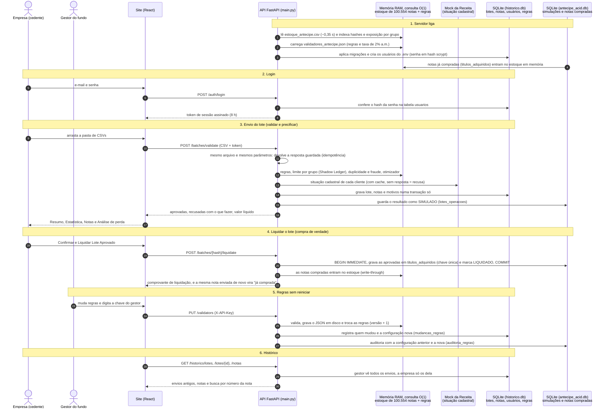
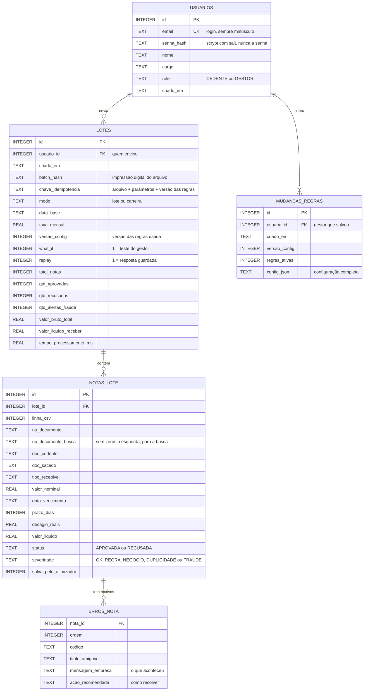
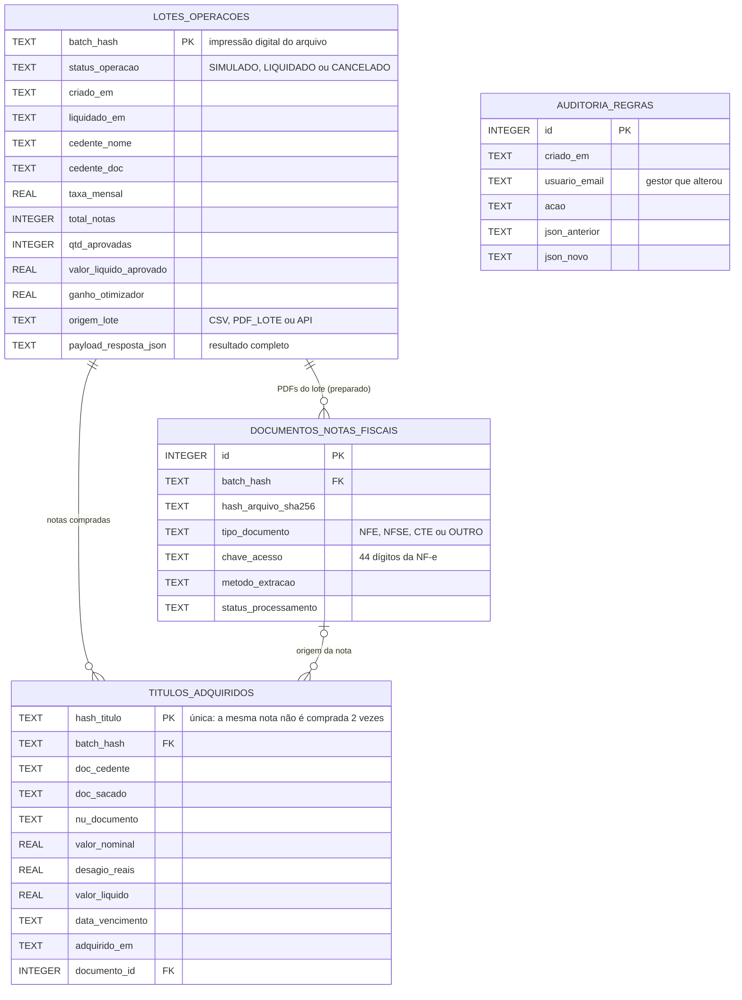

# ANTECIPE PRO

Plataforma de antecipação de recebíveis para o **ANTECIPE FIDC** (Hackathon Antecipe).

A empresa (cedente) envia um lote CSV de notas e recebe na hora quanto vai receber, quais notas foram aprovadas e, para cada recusa, uma explicação em português claro com o que fazer. O gestor do fundo liga, desliga e ajusta as regras de risco pela tela ou pela API, sem deploy, e revalida o lote em tempo real.

## Comece aqui: instalar e usar em 15 minutos

Este passo a passo foi escrito para quem **nunca usou Docker nem programação**. Siga na ordem e copie os comandos exatamente como estão.

### O que você precisa

- Computador com **Windows 10 ou 11 (64 bits)**, **Mac** ou **Linux**
- **8 GB de memória** (recomendado) e uns **5 GB livres** no disco
- **Internet** na primeira vez (para baixar o Docker e montar o sistema)

### Passo 1: Instalar o Docker Desktop

O Docker liga o sistema inteiro (site, servidor e banco de dados) com um único comando, sem instalar Python, Node ou banco à parte.

**Windows**
1. Entre em https://www.docker.com/products/docker-desktop/ e clique em **Download for Windows**.
2. Abra o instalador e deixe marcada a opção **Use WSL 2** (ou "WSL 2 instead of Hyper-V"). Clique em **OK** até terminar.
3. Se ele pedir para **reiniciar o computador**, reinicie.
4. Abra o **Docker Desktop** pelo menu Iniciar, aceite os termos e pule o login (pode clicar em "Skip" ou "Continue without signing in").
5. Espere aparecer **"Engine running"**, com a bolinha verde, no canto inferior esquerdo. Pronto.

> Se aparecer um aviso sobre **WSL**: clique com o botão direito no PowerShell, escolha **Executar como administrador** e rode `wsl --install` (ou `wsl --update`, se ele disser que já está instalado). Reinicie o computador e abra o Docker Desktop de novo.

**Mac:** baixe em https://www.docker.com/products/docker-desktop/ escolhendo **Apple Silicon** (M1, M2, M3...) ou **Intel**, arraste para Aplicativos, abra e espere "Engine running".

**Linux:** instale o Docker Engine e o plugin Compose seguindo https://docs.docker.com/engine/install/ e confira com `docker compose version`.

### Passo 2: Baixar o projeto

**Jeito mais fácil (sem Git):**
1. Entre em https://github.com/FrankTarga/KanaBootCamp, clique no botão verde **Code** e depois em **Download ZIP**.
2. Abra a pasta **Downloads**, clique com o botão direito em `KanaBootCamp-main.zip` e escolha **Extrair tudo...**.
3. Em "Os arquivos serão extraídos para esta pasta", troque o caminho por `C:\Users\SEU-USUÁRIO\Documents` (ou clique em **Procurar** e escolha **Documentos**) e clique em **Extrair**.
4. Dentro de **Documentos** vai aparecer a pasta `KanaBootCamp-main`. Renomeie para **`KanaBootCamp`**. Abra-a e confira: lá dentro devem estar `docker-compose.yml`, `README.md` e as pastas `backend`, `frontend` e `samples`. (Se aparecer só outra pasta `KanaBootCamp-main` dentro, a extração criou uma pasta a mais: use a de dentro.)

**Com Git** (se já tiver instalado):
```powershell
cd $HOME\Documents
git clone https://github.com/FrankTarga/KanaBootCamp.git
```

### Passo 3: Abrir o terminal na pasta do projeto

- **Windows:** abra o **PowerShell** (procure "PowerShell" no menu Iniciar) e digite:
  ```powershell
  cd $HOME\Documents\KanaBootCamp
  ```
- **Mac/Linux:** abra o **Terminal** e digite `cd ~/Documents/KanaBootCamp`

Para ter certeza de que está no lugar certo, digite `ls` e aperte Enter: precisam aparecer `docker-compose.yml` e `.env.example`. Se aparecer "não foi possível encontrar o caminho", confira o nome da pasta do Passo 2.

### Passo 4: Criar o arquivo de configuração (`.env`)

O sistema lê as senhas de um arquivo chamado `.env`. O arquivo que vem do GitHub se chama `.env.example` e já tem tudo preenchido; basta fazer uma cópia dele com o nome `.env`. No terminal, dentro da pasta do projeto:

- **Windows (PowerShell):**
  ```powershell
  Copy-Item .env.example .env
  ```
- **Mac/Linux (Terminal):**
  ```bash
  cp .env.example .env
  ```

> **Recebeu o arquivo `.env` da equipe?** Então pule o comando acima: coloque o arquivo recebido dentro da pasta do projeto (a mesma do `docker-compose.yml`) com o nome exato **`.env`**, sem `.txt` no final. No Windows, confira com `ls -Force` no PowerShell: tem que aparecer `.env`. Nesse caso, as senhas do Passo 6 são as que estão dentro dele (`BANCA_SENHA`, `CEDENTE_SENHA` e, para salvar regras, `ADMIN_API_KEY`); para ver, rode `Get-Content .env`.

Pronto: com esse arquivo, as contas de teste do Passo 6 já funcionam. Para conferir, `Get-Content .env` (Windows) ou `cat .env` (Mac/Linux) mostra as linhas.

> Vai colocar o sistema na internet (VPS)? Antes de ligar, abra o `.env` (`notepad .env`) e troque todos os valores que começam com `troque-` por senhas suas.

### Passo 5: Ligar o sistema

Com o Docker Desktop aberto ("Engine running"):

```powershell
docker compose up -d --build
```

Na primeira vez leva **de 2 a 5 minutos** (ele baixa e monta tudo; a tela vai encher de linhas azuis, é normal). No fim aparecem:

```
✔ Container antecipe-mock-receita  Healthy
✔ Container antecipe-backend       Healthy
✔ Container antecipe-frontend      Started
```

Para conferir a qualquer momento: `docker compose ps`. Se aparecer **"docker não é reconhecido"**, o Docker Desktop não está aberto: abra-o, espere "Engine running", feche e abra o PowerShell de novo e repita os Passos 3 e 5.

### Passo 6: Abrir o site e entrar

Abra **http://localhost:5173** no navegador (Chrome, Edge ou Firefox). Aparece a página inicial: role para baixo ou clique em **Começar** e a tela desce até o login. Lá, **clique no perfil** (Empresa ou Gestor), o e-mail já vem preenchido, **digite a senha** e clique em **Entrar**:

| perfil (escolha na tela) | e-mail | senha | pode |
|---|---|---|---|
| **Empresa (cedente)** | `empresa@antecipe.com.br` | `troque-esta-senha` | enviar notas, ver resultados e contratar |
| **Gestor do fundo** | `banca@antecipe.com.br` | `troque-esta-senha` | tudo isso e mudar as regras do fundo |

**Chave do gestor** (pedida ao salvar regras): `troque-esta-chave`

Esses são os valores do `.env.example`. Se você usou o `.env` enviado pela equipe, as senhas são as que estão dentro dele (`Get-Content .env` mostra).

### Passo 7: Primeiro uso em 3 minutos

1. Entre como **Empresa**.
2. No menu lateral, clique em **Enviar notas**. Abra a pasta do projeto no Explorador de Arquivos, entre na pasta **`samples`** e arraste o arquivo **`01_lote_empresarial_padrao.csv`** para a caixa "Solte a pasta aqui" (ou clique em **Escolher arquivos** e selecione-o).
3. O **Resumo** aparece sozinho: **R$ 184.221,52** na conta hoje, 13 de 22 notas aprovadas.
4. No cartão verde do valor líquido, clique em **Confirmar e Liquidar Lote Aprovado**: o fundo compra as 13 notas e aparece o **Comprovante de Liquidação** (estilo PIX/TED), com o valor liberado, o cedente, os títulos e o protocolo.
5. Clique em **Ver no Histórico** (ou em **Histórico de Lotes** no menu): a operação aparece como **Liquidado**.
6. Explore **Estatística**, **Análise de perda**, **Notas** e **Histórico** no menu lateral.

### Para desligar e ligar de novo

- Desligar: `docker compose down`
- Ligar de novo (rápido, já está montado): `docker compose up -d`
- Atualizar para a versão mais nova: baixe o projeto de novo (ou `git pull`) e rode `docker compose up -d --build`
- Da próxima vez que ligar o computador: abra o Docker Desktop, depois o PowerShell, e rode os Passos 3 e `docker compose up -d`

## Como usar cada parte do site

| parte | para que serve | como usar |
|---|---|---|
| **Página inicial** | explica o sistema com um exemplo | role para baixo ou clique numa opção do menu de cima |
| **Login** | identifica empresa ou gestor | escolha o perfil, digite a senha; vale por 8 horas, inclusive depois do F5. Sair: botão ao lado do nome, no pé do menu |
| **Enviar notas** | manda as notas para análise | arraste uma pasta, um ou vários CSVs. "Notas para antecipar" é o uso normal; "Carteira do fundo" analisa o estoque inteiro (`backend\data\estoque_antecipe.csv`, ~10 s). Pode mudar data, taxa e ligar o Otimizar |
| **Resumo** | quanto cai na conta hoje | extrato (enviado − recusado − custo = líquido), notas aprovadas, ganho do otimizador, alerta de fraude e o botão **Confirmar e Liquidar Lote Aprovado** |
| **Liquidar** | a compra de verdade | "Confirmar e Liquidar Lote Aprovado" grava as notas aprovadas como compradas pelo fundo (transação ACID) e mostra o comprovante, que dá para imprimir. Reenviar a mesma nota depois aparece como "já comprada" |
| **Estatística** | por que as notas foram recusadas | grupos que somam 100% (clique num grupo para ver as notas), liquidez, valor por problema e vencimentos |
| **Análise de perda** | quanto custa esperar | digite um valor e escolha o prazo: mostra quanto recebe e quanto perde |
| **Notas** | nota por nota | clique numa nota para ver o motivo e **Como resolver**; abas, busca e as planilhas **Baixar aprovadas** e **Relatório de recusas** |
| **Histórico** | o que já foi analisado | procurar uma nota pelo número, abrir envios antigos ("Ver notas") e, para o gestor, as mudanças de regras |
| **Histórico de Lotes** | simulações e liquidações gravadas no banco | totais (lotes, liquidados, volume), filtro por status e busca por cedente; **Comprovante** reabre o comprovante de cada liquidação. A empresa vê só os lotes dela |
| **Regras do fundo** (gestor) | mudar o que o fundo aceita sem reiniciar | ligue/desligue regras, **Testar sem salvar** para ver o efeito, e **Salvar e recalcular** com a chave do gestor |
| **Carregar lote demo** | ver as telas sem arquivo | números de exemplo, marcados como "Modo demonstração" |

**Arquivos de teste** (pasta `samples`): `01` lote típico com vários tipos de recusa · `02` otimizador (+R$ 1.620.133,33) · `03` radar de fraude (3 notas já vendidas a outros fundos). O roteiro completo de teste, tela por tela, está no [Guia de uso](GUIA_DE_USO.md).

## Problemas comuns

| o que aparece | o que fazer |
|---|---|
| `docker` não é reconhecido como comando | o Docker Desktop não está instalado ou aberto. Abra-o e espere "Engine running"; feche e abra o PowerShell de novo |
| erro sobre **WSL** ou virtualização ao abrir o Docker | PowerShell como administrador: `wsl --update`, reinicie. Se persistir, ative a virtualização na BIOS (procure o modelo do seu computador + "ativar virtualização") |
| "Falha de conexão com a API" na tela de login | o sistema não está ligado. Rode `docker compose up -d` e confira com `docker compose ps` |
| "E-mail ou senha incorretos" com a senha certa | o `.env` não foi criado (Passo 4), a senha é a de `BANCA_SENHA`/`CEDENTE_SENHA` do `.env`, ou o perfil escolhido não é o da conta. Corrija e rode `docker compose up -d --build` |
| o site não abre em localhost:5173 | outra coisa usa a porta (por exemplo um `npm run dev`). Feche-a e rode o Passo 5 de novo |
| o `backend` não fica "Healthy" | `docker compose logs backend --tail 40` mostra o motivo |
| salvar regras dá erro de chave | digite em "Chave do gestor" o valor de `ADMIN_API_KEY` do `.env` (no modelo: `troque-esta-chave`) |
| reenviei um lote e todas as notas aparecem como "já comprada" | é o esperado depois de **Liquidar**. Para recomeçar do zero, veja abaixo |
| **recomeçar do zero** (apagar envios e compras) | `docker compose down`, apague os arquivos `historico.db*` e `antecipe_acid.db*` dentro de `backend\data` e rode `docker compose up -d` |
| na VPS Linux, `unable to open database file` | `sudo chown -R 1000:1000 backend/data` e `docker compose up -d` |
| na VPS, o site não fala com a API | no `.env`, `VITE_API_URL=http://IP-DA-VPS:8000/api/v1`, e `docker compose up -d --build` |

Endereços úteis: site http://localhost:5173 · API http://localhost:8000/api/v1 · documentação interativa da API http://localhost:8000/docs

<details>
<summary><strong>Para desenvolvedores: rodar sem Docker</strong></summary>

Sem Docker (PowerShell, Windows), um terminal por serviço:

```powershell
cd backend
python -m venv .venv
.\.venv\Scripts\pip install -r requirements-dev.txt
```

```powershell
# mock da Receita Federal (porta 8001)
.\backend\.venv\Scripts\python -m uvicorn main:app --app-dir mock-receita --port 8001
```

```powershell
# API (porta 8000); use 127.0.0.1, porque no Windows "localhost" tenta IPv6 antes e atrasa ~2 s
$env:RECEITA_API_URL = "http://127.0.0.1:8001/api/cnpj/v1"
$env:ADMIN_API_KEY = "troque-esta-chave"
cd backend
.\.venv\Scripts\python -m uvicorn app.main:app --port 8000
```

```powershell
cd frontend
npm install
npm run dev
```

### Testes do back-end

Executar todos os testes automatizados da suíte:
```powershell
cd backend
.\.venv\Scripts\python -m pytest tests -q
```

#### Testes Automatizados (pytest)
Suíte com 5 testes unitários diretos cobrindo o core de validação, motor quantitativo e Shadow Ledger (`backend/tests/test_engine.py`):

1. `test_calculo_desagio_data_base_quinta_feira()` — Cálculo de deságio comercial com data-base em dia útil (quinta-feira).
2. `test_concentracao_acumulativa_intra_lote()` — Shadow Ledger: estanca concentração cumulativa intra-lote em tempo real.
3. `test_radar_antifraude_outro_fundo()` — Radar antifraude: bloqueia duplicidade/dupla cessão em outro fundo via hash canônico SHA-256.
4. `test_otimizador_lote_aumenta_valor_liquido()` — Smart Batch Optimizer: mochila 0/1 maximizando o valor líquido a receber.
5. `test_hot_reload_validadores_sem_deploy()` — Zero-Deploy: atualização atômica de validadores em memória sem reinicialização.

Comando para rodar os 5 testes unitários:
```powershell
cd backend
.\.venv\Scripts\pytest -v tests/test_engine.py -k "test_calculo_desagio_data_base_quinta_feira or test_concentracao_acumulativa_intra_lote or test_radar_antifraude_outro_fundo or test_otimizador_lote_aumenta_valor_liquido or test_hot_reload_validadores_sem_deploy" -o "addopts="
```

Resultado dos testes:
```text
============================= test session starts =============================
platform win32 -- Python 3.14.7, pytest-9.1.1, pluggy-1.7.0 -- backend\.venv\Scripts\python.exe
cachedir: .pytest_cache
rootdir: backend
plugins: anyio-4.15.1, cov-7.1.0
collecting ... collected 5 items

tests/test_engine.py::test_calculo_desagio_data_base_quinta_feira PASSED [ 20%]
tests/test_engine.py::test_concentracao_acumulativa_intra_lote PASSED    [ 40%]
tests/test_engine.py::test_radar_antifraude_outro_fundo PASSED           [ 60%]
tests/test_engine.py::test_otimizador_lote_aumenta_valor_liquido PASSED  [ 80%]
tests/test_engine.py::test_hot_reload_validadores_sem_deploy PASSED      [100%]

============================== 5 passed in 0.10s ==============================
```

</details>

## Como funciona por dentro (diagramas)

**A memória e os bancos trabalham juntos.** A validação acontece na memória RAM: o estoque de 100.554 notas é indexado uma vez, quando o servidor liga, e cada consulta (duplicidade, fraude, exposição por grupo) é O(1). Dois arquivos SQLite guardam o que precisa durar:

- `historico.db` (`historico.py`): usuários, cada envio com suas notas e motivos, e cada mudança de regra. É o que a tela **Histórico** mostra.
- `antecipe_acid.db` (`database.py`): cada lote como **SIMULADO** e, ao **Liquidar** (botão "Confirmar e Liquidar Lote Aprovado"), a compra de verdade numa transação ACID (`BEGIN IMMEDIATE`). As notas compradas vão para `titulos_adquiridos`, com chave única que impede comprar a mesma nota duas vezes, e entram na memória na hora (write-through). Quando o servidor liga, elas são recarregadas para a memória.



**Tabelas do `historico.db`** (criadas e migradas sozinhas pelo `historico.py`). A carteira de 100 mil notas guarda só o resumo em `lotes`; os lotes de notas guardam também cada nota e cada motivo.



**Tabelas do `antecipe_acid.db`** (criadas pelo `database.py`). `documentos_notas_fiscais` já está pronta para a leitura de PDFs de notas fiscais (ver *Próximos passos*).



Os mesmos diagramas em imagem, para slides: [`docs/diagramas/`](docs/diagramas/).

## Testes automatizados e simulador de stress

**188 testes com pytest, todos passando** (`cd backend; python -m pytest tests -q`). Os cinco cenários de negócio que mais pesam na avaliação têm um arquivo próprio, [`backend/tests/test_cenarios_banca.py`](backend/tests/test_cenarios_banca.py), um teste por cenário:

| teste | o que garante |
|---|---|
| `test_calculo_desagio_data_base_quinta_feira` | data-base = D+1 útil da maior aquisição (quarta 21/10 → quinta 22/10/2026); R$ 10.000 em 30 dias a 2% a.m. = R$ 200 de deságio e R$ 9.800 líquidos |
| `test_concentracao_acumulativa_intra_lote` | o teto de 10% soma o estoque **e** o que já foi aprovado no próprio lote (Shadow Ledger); cada nota sozinha passaria, a terceira estoura; o estoque em memória não muda |
| `test_radar_antifraude_outro_fundo` | título idêntico a um da carteira de outro fundo vira FRAUDE (dupla cessão), mesmo com o valor escrito de outro jeito, e não entra no dinheiro do lote |
| `test_otimizador_lote_aumenta_valor_liquido` | com o limite do cliente apertado, o otimizador troca a nota longa por duas curtas: mais notas aprovadas, mais líquido, resposta na ordem do CSV |
| `test_hot_reload_validadores_sem_deploy` | o gestor desliga uma regra com o sistema no ar: a validação seguinte já usa a regra nova, a versão sobe e o JSON em disco é atualizado |

```
$ python -m pytest tests/test_cenarios_banca.py -v
collecting ... collected 5 items
tests/test_cenarios_banca.py::test_calculo_desagio_data_base_quinta_feira PASSED [ 20%]
tests/test_cenarios_banca.py::test_concentracao_acumulativa_intra_lote PASSED [ 40%]
tests/test_cenarios_banca.py::test_radar_antifraude_outro_fundo PASSED   [ 60%]
tests/test_cenarios_banca.py::test_otimizador_lote_aumenta_valor_liquido PASSED [ 80%]
tests/test_cenarios_banca.py::test_hot_reload_validadores_sem_deploy PASSED [100%]
============================== 5 passed in 0.03s ===============================
```

**Simulador de stress** ([`scripts/simulador_stress.py`](scripts/simulador_stress.py)): gera lotes sintéticos com clientes reais do estoque e mede o próprio motor (sem HTTP), com a mediana de 3 execuções por tamanho:

```
$ python scripts/simulador_stress.py
Estoque carregado: 100.554 linhas em 0,33 s

   notas | tempo (mediana) |   notas/s | aprovadas | ganho otimizador
----------------------------------------------------------------------
   1.000 |          0,06 s |    16.214 |     59,9% | R$          0,00
   5.000 |          0,29 s |    17.206 |     62,3% | R$    151.662,27
  10.000 |          0,68 s |    14.780 |     62,3% | R$    107.457,97

Carteira inteira (modo carteira): 100.554 notas em 4,51 s (22.298 notas/s)
```

## Estrutura

```
├── backend/                  FastAPI (Python 3.12+)
│   ├── app/
│   │   ├── main.py           rotas REST, CORS, lifespan, erros padronizados, cache de idempotência
│   │   ├── api_schemas.py    modelos Pydantic v2 = contrato da API
│   │   ├── stock_index.py    índice O(1) em RAM do estoque (100k linhas em ~0,7 s)
│   │   ├── rule_engine.py    motor de regras zero-deploy, Shadow Ledger, anti-fraude, tradutor de erros
│   │   └── quant_analytics.py precificação, parse BR e Smart Batch Optimizer (Estatístico)
│   ├── data/                 estoque, validadores_antecipe.json, situacao_cadastral.json
│   └── tests/                pytest (motor + API)
├── frontend/                 React + Vite + Tailwind + TypeScript
│   └── src/
│       ├── components/       componentes visuais
│       ├── services/         cliente da API (api.ts) + mock (mockLote.json)
│       ├── types/            tipos TS espelhados do contrato (api.ts)
│       └── App.tsx
├── mock-receita/             mock da consulta de CNPJ da Receita (formato BrasilAPI)
├── samples/                  massas de demo para os jurados
├── prompts-ia/               histórico das conversas com IA (requisito do hackathon)
└── docker-compose.yml
```

| pasta | dono |
|---|---|
| `backend/app/` (menos `quant_analytics.py`), `docker-compose.yml` | Dev 1 · Back-end |
| `frontend/` | Dev 2 · Front-end |
| `backend/app/quant_analytics.py`, `samples/` | Estatístico · Quant |

## Contrato da API

| método | rota | uso |
|---|---|---|
| GET | `/api/v1/health` | estado do motor e estatísticas do estoque |
| GET | `/api/v1/validators` | JSON de regras atual |
| PUT | `/api/v1/validators` | troca as regras em memória e salva em disco (sem restart); exige header `X-API-Key` = env `ADMIN_API_KEY` (401 sem a chave, 403 se a env não estiver definida) |
| POST | `/api/v1/portfolio/validate` | `multipart/form-data`: `file` (carteira/estoque inteiro). Saída no formato do gabarito oficial; ver *Modo carteira* |
| GET | `/api/v1/historico/*` | exigem `Authorization: Bearer <token do /auth/login>` (401 sem sessão). Cedente vê só os lotes que enviou; gestor vê todos |
| GET | `/api/v1/historico/lotes?limite=50&offset=0` | histórico de validações (SQLite): chave completa, parâmetros, totais e se veio do cache. Paginado, mais recente primeiro |
| GET | `/api/v1/historico/lotes/{id}?limite=500&offset=0` | um lote antigo com suas notas e os motivos de recusa, como a empresa recebeu (só no modo lote; na carteira, só o resumo) |
| GET | `/api/v1/historico/notas?nu_documento=351156` | em quais lotes um número de nota apareceu e o que aconteceu com ela (zeros à esquerda ignorados) |
| GET | `/api/v1/historico/regras?limite=50&offset=0` | auditoria: cada `PUT /validators` aceito, com versão, data e o JSON das regras. Só gestor (403 para cedente) |
| POST | `/api/v1/batches/validate` | `multipart/form-data`: `file`, `data_base?`, `taxa_mensal?`, `otimizar_lote?`, `validadores_override?`, `modo?` (`lote`, o padrão, ou `carteira`) |

Os tipos exatos estão em [`frontend/src/types/api.ts`](frontend/src/types/api.ts), espelho de [`backend/app/api_schemas.py`](backend/app/api_schemas.py). Mudou um, muda o outro no mesmo commit.

- **Taxa de deságio: fonte única = `precificacao.taxa_mensal_percentual` do JSON** (hoje 2,0% a.m.). O `/health` devolve essa taxa já em decimal em `taxa_mensal_padrao` (0.02) para o Front preencher o input. O campo `taxa_mensal` do form só deve ser enviado quando o usuário altera a taxa (simulação); o 0,025 vale apenas se o JSON não tiver o bloco `precificacao`. A taxa usada de fato sempre volta em `meta.taxa_mensal_aplicada`. Para mudar a taxa do fundo: `PUT /validators`.
- **Situação cadastral fail-closed:** o back-end consulta `RECEITA_API_URL` (BrasilAPI real ou `mock-receita/`) para cada CNPJ de sacado do lote, em paralelo e com cache de 1 h. CNPJ não encontrado ou consulta que falhou = nota recusada. Sem `RECEITA_API_URL`, a fonte é `backend/data/situacao_cadastral.json` (e CNPJ ausente do arquivo também é recusado).
- **Prazo mínimo de cobrança:** `precificacao.prazo_minimo_cobranca_dias` (hoje 5). Nota que vence em menos dias, inclusive na própria data-base, é aceita se passar nas regras, mas paga deságio de 5 dias.
- **API key na gaveta do gestor:** o gestor digita a chave e o Front guarda em `sessionStorage`. Nunca coloque a chave em `VITE_*`, porque vai parar no JavaScript público.
- **`analise_recusas`** (em toda resposta de `/batches/validate`, nos modos lote e carteira e no what-if): o painel de recusas do Estatístico. Grupos que somam 100%, combinações de problemas e quanto dinheiro cada correção libera. Contrato em [`docs/analise-recusas.md`](docs/analise-recusas.md); o front mostra os números como vêm. A busca por número da nota usa os `itens` que já vêm na resposta.
- `validadores_override` (opcional): JSON de regras só para aquela validação. É o **what-if** do gestor e não persiste nada.
- Header `X-Idempotent-Replay: true` quando o mesmo arquivo, com os mesmos parâmetros e a mesma versão de regras, já foi processado.
- Erros sempre em `{"error": {"code", "message", "details"}}`.
- `linha_csv` é a linha física do arquivo (cabeçalho = linha 1), igual ao número da linha no Excel.

## Modo carteira (gabarito oficial)

Para a tela, `POST /api/v1/batches/validate` com `modo=carteira` devolve a resposta completa (status, motivo explicado, valor líquido e total) com as regras do gabarito. Para conferência automática, `POST /api/v1/portfolio/validate` (multipart `file`) ou a CLI julgam **cada linha de um estoque** contra as regras do fundo e devolvem exatamente o formato de `resultado_esperado_100k.json`: `[{"linha", "id", "status": "APROVADO" | "BARRADO", "barrado_por"?}]`.

```powershell
cd backend
.\.venv\Scripts\python -m app.validar_carteira data\estoque_antecipe.csv saida.json
```

Diferenças em relação ao modo lote:
- prazo e vencimento contam a partir da `DATA_AQUISICAO` da própria linha;
- a concentração é **estática por fundo**: se a raiz do sacado passa do teto sobre as notas elegíveis daquele fundo, todas as notas dela são barradas (e ela só é avaliada em nota sem outro erro);
- não há radar de duplicidade, porque o arquivo é o próprio estoque;
- não há limite de linhas (o estoque inteiro, com 100.554 notas, leva ~10 s); o modo lote continua limitado a `MAX_LINHAS_LOTE`.

Quando usar cada modo: **lote** é a empresa oferecendo notas novas ao fundo (confere duplicidade contra o estoque, otimiza a ordem e calcula a concentração contra a carteira atual); **carteira** é conferir um arquivo inteiro de títulos, que é como o gabarito oficial foi gerado.

`tests/test_conformidade_gabarito.py` compara as 100.554 linhas com o gabarito: **100% idênticas**, inclusive pelo endpoint ao vivo com o mock da Receita. A situação cadastral vem de `backend/data/situacao_cadastral.json`, gerado por `backend/gerar_situacao_cadastral.py` a partir do próprio gabarito (os 87 CNPJs barrados por `SITUACAO_CADASTRAL_SACADO`). Foi uma decisão do time: o kit não trouxe a fonte da organização, e os CNPJs do dataset são sintéticos, então a Receita real diverge. O gabarito não diz qual é a situação, só que não é ATIVA; por isso o rótulo é `IRREGULAR`. O mock responde ATIVA para qualquer outro CNPJ com dígito verificador válido (é o que o gabarito implica) e 404 para CNPJ inválido.

## Situação cadastral: três fontes, uma escolha

A regra `SITUACAO_CADASTRAL_SACADO` precisa saber se o CNPJ do sacado está ATIVA. Temos três fontes, e elas **se contradizem**, então o mock da Receita deixa escolher por `SITUACAO_FONTE` sem mudar código:

| `SITUACAO_FONTE` | de onde vem | iguais ao gabarito (100.554 linhas) |
|---|---|---|
| `gabarito` (padrão) | `backend/data/situacao_cadastral.json`: os 87 CNPJs barrados por situação no `resultado_esperado_100k.json` | **100.554** |
| `kanastra` | `backend/data/cnpj_situacao_mock.csv`, publicado pela organização no Notion (42 não-ATIVA). CNPJ ausente = ATIVA | 97.460 |
| `formato` | nenhuma restrição; vale só a checagem do CNPJ (14 dígitos + dígito verificador, em `CNPJ_SACADO_VALIDO`) | 98.237 |

O arquivo oficial e o gabarito não têm **nenhum** CNPJ irregular em comum. Dos 87 irregulares do gabarito, 55 aparecem como ATIVA no arquivo e 32 nem estão nele. Dos 42 não-ATIVA do arquivo, o gabarito aprova as notas de 694 linhas. Em todas as fontes, as demais regras batem com o gabarito em 100%. O padrão é `gabarito` por decisão do time; o `GET /health` do mock mostra a fonte ativa.

## Diferenciais técnicos

1. **Índice O(1) em RAM.** No startup, as 100.554 linhas do estoque viram HashMaps: títulos do ANTECIPE, títulos dos outros 17 fundos e exposição por sacado e cedente (por CNPJ e por raiz).
2. **Shadow Ledger.** Cada nota aprovada soma imediatamente na exposição do sacado, do cedente e do patrimônio antes da próxima ser avaliada, então limites estouram no meio do lote com precisão.
3. **Smart Batch Optimizer.** O motor simula várias ordens de avaliação (original, mochila 0/1 por grupo de concentração, menor prazo, maior valor) e devolve a de maior valor líquido para a empresa, marcando as notas `salva_pelo_otimizador`.
4. **Triplo radar anti-fraude.** A chave canônica (cedente, sacado, nº da nota, valor, vencimento) vira um SHA-256 e detecta nota repetida no lote, nota já comprada pelo ANTECIPE e nota já vendida a outro fundo (dupla cessão). Zeros à esquerda do número da nota são ignorados, porque o Excel os apaga.
5. **Sem short-circuit + tradutor de economês.** Todas as regras ativas rodam em todas as notas; cada recusa traz título curto, mensagem com os números reais da nota e uma ação recomendada.
6. **Zero-Deploy.** O `PUT /validators` valida o schema (códigos, tipos e faixas dos parâmetros), troca a config de forma atômica e grava o JSON; o what-if simula sem salvar.

Data-base padrão: **22/10/2026**, o próximo dia útil após a maior `DATA_AQUISICAO` do estoque (21/10). Nunca é a data do relógio; pode ser forçada pela env `DATA_BASE_PADRAO` ou pelo campo `data_base`.

## Roteiro de demo

| arquivo | o que mostra |
|---|---|
| [`01_lote_empresarial_padrao.csv`](samples/01_lote_empresarial_padrao.csv) | lote típico da FÁBRICA DE TINTAS VARGINHA: 22 notas, 13 aprovadas (R$ 184.221,52 líquidos) e recusas por vencida, prazo > 180 dias, valor < R$ 100, cheque, CNPJ inválido, situação cadastral irregular (2 clientes da lista de referência), concentração (a SERRALHERIA VIOLETA já tem 12,5% da carteira) e uma nota com 3 violações ao mesmo tempo |
| [`02_demo_otimizador_concentracao.csv`](samples/02_demo_otimizador_concentracao.csv) | DIVINÓPOLIS perto do teto de 10%: na ordem do CSV a nota de R$ 3 mi (75 dias) consome o limite; o otimizador aprova as de R$ 2,3 mi e R$ 2,2 mi (8 e 12 dias): **+R$ 1.620.133,33** e 2 notas salvas |
| [`03_demo_radar_antifraude.csv`](samples/03_demo_radar_antifraude.csv) | nota repetida no lote, 2 notas já compradas pelo ANTECIPE (uma com os zeros cortados pelo Excel) e 3 notas já na carteira de outros fundos (alerta de fraude) |

Zero-deploy ao vivo: suba o `01`, desative `VALOR_MINIMO` ou ative `PRAZO_MINIMO` (gaveta do gestor ou `PUT /api/v1/validators`) e revalide; o resultado muda sem reiniciar nada.
## Modelagem Matemática, Decisões de Algoritmo e Análise de Dados

### Precificação: desconto comercial simples, pro-rata die (2% a.m.)

Cada nota é precificada por `precificar()` em `quant_analytics.py`, usando desconto comercial simples na convenção de `base_dias` (30, conforme `validadores_antecipe.json -> precificacao`):

```
deságio      = valor_nominal * (taxa_mensal / base_dias) * prazo_dias
valor_líquido = valor_nominal - deságio
```

A taxa usada é resolvida por `RuleEngine.taxa_configurada()`: se `validadores_antecipe.json` tiver o bloco `precificacao.taxa_mensal_percentual`, essa é a taxa aplicada — **2,0% a.m.**, a taxa que o fundo efetivamente configurou — e só cai para o default de 2,5% a.m. da API se o bloco não existir. O gestor pode trocar essa taxa a qualquer momento pela tela "Zero-Deploy" sem redeploy.

O módulo também suporta desconto composto (`DESCONTO_COMPOSTO`), caso o fundo decida migrar de convenção no futuro, sem alterar o contrato da API.

### Smart Batch Optimizer: mochila 0/1 real, não apenas reordenação gulosa

Quando o limite de concentração de um sacado ou cedente é insuficiente para todas as notas elegíveis de um lote, o problema é formalmente um **Knapsack Problem 0/1** sob restrição de capacidade: maximizar a soma do valor líquido das notas aceitas sem ultrapassar a folga de concentração disponível.

`ordenar_lote_otimizado()` resolve isso em três passos:

1. **Notas de grupos sem pressão de concentração** entram primeiro, ordenadas por menor prazo — elas aumentam o patrimônio do fundo e abrem espaço (folga) para os grupos que estão sob pressão, sem custo de oportunidade algum.
2. **Grupos pressionados** (onde a soma das notas elegíveis excede a folga projetada) passam por uma **mochila 0/1 por programação dinâmica** (`_mochila()`), que escolhe o subconjunto de notas que maximiza Σ valor líquido dentro da folga restante — com a capacidade discretizada em até 2.000 níveis de resolução para manter o tempo de execução em milissegundos mesmo em lotes grandes.
3. O motor (`rule_engine.gerar_ordens_candidatas`) simula essa ordem e mais 4 ordens candidatas (original do CSV, por menor prazo, por maior valor, por menor valor) e fica com a que realmente produz o maior valor líquido simulado — nunca assume que a heurística ganhou sem checar.

Essa abordagem é estritamente melhor do que apenas ordenar por eficiência de deságio: a mochila encontra a combinação ótima de notas para a folga disponível, mesmo quando a nota "mais eficiente" sozinha não é a melhor escolha em conjunto com as demais.

### Validação stateful (Shadow Ledger) e concentração por raiz de CNPJ

A concentração de crédito é avaliada de forma acumulativa dentro do próprio lote: a cada nota aprovada, seu valor nominal é somado imediatamente a um `ShadowLedger` (overlay em memória sobre as exposições do estoque) antes da próxima nota ser avaliada. Isso impede que três notas de R$ 5.000 para o mesmo sacado, com limite de R$ 10.000, sejam todas aprovadas só porque a validação olhou apenas a foto estática do estoque inicial.

`CONCENTRACAO_MAXIMA_SACADO` usa `agrupamento: "RAIZ_CNPJ"` — a exposição é somada pelos 8 primeiros dígitos do CNPJ, ignorando a filial, para que duas filiais do mesmo grupo econômico não "driblem" o teto abrindo CNPJs de filial diferentes. Para CPF (pessoa física) não existe esse conceito e o documento completo é usado.

### Triplo radar de duplicidade/fraude

A identidade canônica de um título é `doc_cedente|doc_sacado|nu_documento|valor_nominal|data_vencimento`, normalizada e transformada em SHA-256 (`stock_index.gerar_hash_titulo`). A normalização do `NU_DOCUMENTO` remove zeros à esquerda em campos puramente numéricos — um detalhe que importa na prática: o Excel converte `"000351156"` em `"351156"` ao salvar, e sem essa normalização um recebível reenviado escaparia do radar de duplicidade. Essa chave sustenta 3 níveis de verificação:

1. **`DUPLICIDADE_LOTE`** — a mesma chave aparece duas vezes no próprio arquivo enviado.
2. **`DUPLICIDADE_FUNDO`** — a chave já existe na carteira histórica do ANTECIPE FIDC.
3. **`FRAUDE_OUTRO_FUNDO`** — a chave existe no estoque associada a outro dos 17 fundos do mercado (indício de dupla cessão).

### Análise do estoque real (100.554 linhas)

Rodando `scripts/raio_x_e_gerador_samples.py` contra o `estoque_antecipe.csv` completo:

- **10.621 linhas** pertencem ao ANTECIPE FIDC, com **patrimônio de R$ 53.074.028,00**.
- Data-base detectada automaticamente: **22/10/2026** (dia útil seguinte à maior `DATA_AQUISICAO` do estoque, 21/10/2026).
- **Achado relevante para o gestor:** o sacado SERRALHERIA VIOLETA S.A. (58.206.002/0001-11) já está **exatamente no teto de 10% de concentração** (R$ 6.634.253,50 acumulados, limite R$ 5.307.402,80 projetado — ou seja, já ultrapassado hoje, considerando o patrimônio atual). Qualquer nova nota para esse sacado será recusada pela regra `CONCENTRACAO_MAXIMA_SACADO` até o patrimônio do fundo crescer ou títulos existentes dele serem liquidados. Vale mostrar esse caso real na demo para os jurados — é exatamente o cenário que o Shadow Ledger e o Smart Batch Optimizer existem para proteger.
- Entre os cedentes, os 5 maiores já ultrapassam o teto de 8% de `CONCENTRACAO_MAXIMA_CEDENTE` — mas essa regra está **inativa** no `validadores_antecipe.json` atual, então não bloqueia hoje (o gestor pode ativá-la pela tela Zero-Deploy a qualquer momento para ver esses cedentes passarem a ser limitados).

### Massas de demonstração (`samples/`)

Os 3 CSVs em `samples/` já estão ajustados aos números do "Roteiro de demo" acima e não foram alterados por esta análise. `scripts/raio_x_e_gerador_samples.py` fica disponível no repositório para regenerá-los a partir do estoque real sempre que for preciso (por exemplo, se o `estoque_antecipe.csv` for atualizado antes da apresentação) — mas regenerar troca os números citados no Roteiro de demo, então só rodar de novo com o time ciente, revisando o README junto.

## Relatório

**O que construímos.** Um portal de antecipação para o ANTECIPE FIDC. A empresa envia o CSV e vê, para cada nota, se foi aprovada ou recusada, o motivo explicado em português simples com o que fazer, o valor líquido de cada nota e o total a receber. O gestor muda as regras pela tela ou pela API sem deploy e simula o efeito antes de salvar. A mesma validação existe pela tela e pela API, e o modo carteira reproduz o gabarito oficial nas 100.554 linhas.

**Tecnologias.** Back-end em Python 3.12 + FastAPI + Pydantic v2, com o estoque indexado em memória para leitura O(1) e SQLite (biblioteca padrão) só para o histórico de lotes e a auditoria das regras. Front-end em React + Vite + Tailwind + TypeScript. Mock da Receita em FastAPI no formato da BrasilAPI. Testes com pytest (188 testes; os 5 cenários principais em `test_cenarios_banca.py`) e simulador de stress. Tudo sobe com Docker Compose.

**Principais decisões.**
- Regras 100% lidas do `validadores_antecipe.json`, validadas no `PUT` e trocadas em memória sem reiniciar.
- Dois modos de validação (lote e carteira), porque notas novas e uma carteira inteira são problemas diferentes. O detalhe está na RFC.
- Situação cadastral fail-closed: sem confirmação de CNPJ ativo, a nota não é comprada.
- Chave de duplicidade que ignora os zeros à esquerda do número da nota (o Excel os apaga).
- Desconto comercial simples com prazo mínimo de cobrança de 5 dias.

**O que ficou de fora.**
- Situação cadastral real: o kit não trouxe a fonte da organização, e a Receita real diverge dos CNPJs sintéticos do dataset. Usamos uma lista de referência extraída do gabarito (decisão do time).
- Liquidar registra a compra e atualiza o estoque em memória, mas não emite o termo de cessão nem faz o pagamento de verdade.
- Perfis: login com dois perfis (empresa e gestor); o `PUT` das regras exige também a chave do gestor.
- Escala horizontal: o estado fica em memória, então a API roda com 1 processo.
- Feriados: a data-base D+1 útil considera só os fins de semana.

**Próximos passos.**
- **Ler notas fiscais em PDF.** Uma pasta de PDFs vira um lote no mesmo formato do CSV. Primeiro um caminho rápido e gratuito: ler o texto do DANFE (`pdfplumber`), achar a chave de acesso de 44 dígitos (conferida pelo dígito verificador) e o bloco *Fatura/Duplicatas*, porque uma NF-e pode virar várias duplicatas, cada uma com valor e vencimento. Antes de entrar no lote, cada nota é conferida: dígitos dos CNPJs, soma das duplicatas igual ao total e datas válidas; o que não passa vai para um relatório, em vez de gerar dado errado. PDFs escaneados e NFS-e (cada prefeitura com um layout) ficam para um segundo caminho com OCR ou modelo de visão, sempre com conferência humana antes de validar. A tabela `documentos_notas_fiscais` já existe no banco para guardar a origem de cada nota.
- **Termo de cessão e pagamento** depois de liquidar.
- **Feriados nacionais** no cálculo da data-base.

Detalhes técnicos em [`docs/rfcs/0001-backend-antecipe-pro.md`](docs/rfcs/0001-backend-antecipe-pro.md).
