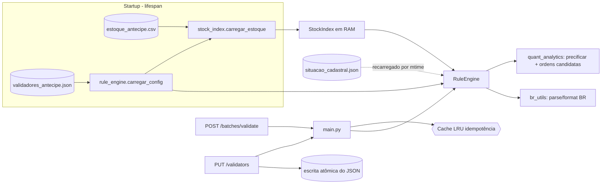
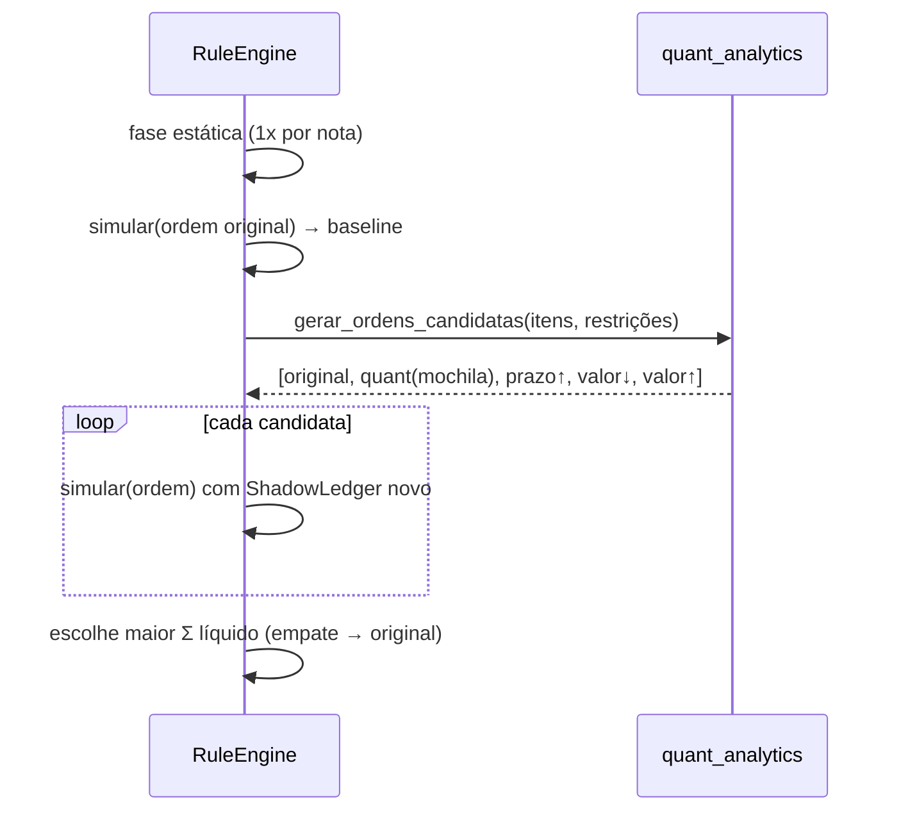

# RFC 0001: Back-end do ANTECIPE PRO (motor de elegibilidade, precificação e anti-fraude)
- **Status:** Rascunho
- **Autor:** Eduardo
- **Data:** 24/10/2026

## Contexto e problema

O ANTECIPE FIDC compra recebíveis (duplicatas) de empresas cedentes. Hoje o fundo precisa de um serviço que:

1. receba um **lote CSV** de notas de um cedente;
2. valide cada nota contra as **regras de risco** de `validadores_antecipe.json` e contra o **estoque histórico** (`estoque_antecipe.csv`, 100.554 títulos de 18 fundos, 10.621 deles do ANTECIPE);
3. calcule o **preço de compra** (valor nominal − deságio);
4. explique cada recusa em linguagem simples para a empresa;
5. deixe o gestor **mudar as regras sem deploy**.

Restrições:

- **Prazo:** hackathon, entrega às 18h de 24/10/2026.
- **Time:** 3 pessoas (Back-end, Front-end, Estatístico), com um contrato REST fixo entre as partes.
- **Data-base:** não pode ser a data do relógio. O dataset é de quinta-feira, 22/10/2026, e hoje é sábado.
- **Sem banco de dados:** o estoque vem só de um CSV e cabe em memória com folga.

O que o estoque mostra (perfil real dos dados):

- O patrimônio do ANTECIPE soma R$ 53.074.028,00, dos quais 203 títulos (R$ 919 mil) já estão vencidos.
- A raiz de sacado `58206002` (SERRALHERIA VIOLETA) já concentra **12,5%** do fundo, acima do teto de 10%. Pelo CNPJ completo seriam só 5,09%, por isso o agrupamento por raiz de CNPJ é obrigatório.
- O estoque não tem nenhuma chave duplicada, nem dentro de um fundo nem entre fundos; duplicidade e fraude só vêm do upload.
- 16 mil títulos têm `NU_DOCUMENTO` com zeros à esquerda, que o Excel apaga ao salvar o CSV.

## Objetivos / Não-objetivos

**Objetivos**
- Validar um lote típico (até ~500 notas) em **menos de 15 ms**, com o estoque carregado em **menos de 1 s** no startup.
- Implementar 100% dos códigos do `validadores_antecipe.json` sem nenhum limite fixo no código.
- Avaliar todas as regras ativas em todas as notas (sem short-circuit), com mensagem e ação recomendada para cada recusa.
- Aplicar os limites de concentração de forma **stateful dentro do lote**, considerando as notas já aprovadas antes.
- Maximizar o valor líquido do cedente reordenando o lote, sem nunca piorar o resultado da ordem original.
- Detectar duplicidade em 3 níveis: dentro do lote, contra o próprio fundo e contra os outros 17 fundos (fraude de dupla cessão).
- Trocar regras via API em tempo real, com persistência e what-if sem persistência.

**Não-objetivos**
- Persistir as operações aprovadas (efetivar a cessão) ou atualizar o estoque após a compra.
- Autenticação e autorização (o `PUT /validators` está aberto; ver Riscos).
- Rodar com vários processos ou réplicas horizontais.
- Consultar a Receita Federal online.
- Usar calendário de feriados (D+1 útil considera só os fins de semana).

## Proposta

### Arquitetura



| módulo | responsabilidade | dono |
|---|---|---|
| `backend/app/main.py` | FastAPI, CORS, lifespan, rotas, formato de erro, request id, cache de idempotência | Dev 1 |
| `backend/app/api_schemas.py` | modelos Pydantic v2 = contrato (espelhado em `frontend/src/types/api.ts`) | Dev 1 |
| `backend/app/stock_index.py` | `carregar_estoque`, `gerar_hash_titulo`, normalização de documentos e do número da nota | Dev 1 |
| `backend/app/rule_engine.py` | `RuleEngine`, `ShadowLedger`, registro `REGRAS`, handlers, tradutor de mensagens, leitura do CSV de upload | Dev 1 |
| `backend/app/br_utils.py` | parse e formatação de valores e datas no padrão BR, prazo, D+1 útil | Dev 1 |
| `backend/app/quant_analytics.py` | `precificar`, `gerar_ordens_candidatas`, `ordenar_lote_otimizado` | Estatístico |

O estado (config, índice, cache) vive em memória num **único processo uvicorn com 1 worker**.

### Índice do estoque (`stock_index.carregar_estoque`)

A leitura é feita uma única vez, com `split` quando o arquivo não tem aspas (2,5x mais rápido que o módulo `csv`) e memoização dos documentos normalizados. Estruturas montadas:

| estrutura | tipo | uso |
|---|---|---|
| `hashes_antecipe` | `dict[hash → data_aquisicao]` | `DUPLICIDADE_FUNDO` (a data entra na mensagem) |
| `hashes_outros_fundos` | `dict[hash → nome_fundo]` | `FRAUDE_OUTRO_FUNDO` |
| `exposicao_sacado`, `exposicao_sacado_raiz` | `dict[doc → R$]` | concentração por CNPJ ou por raiz |
| `exposicao_cedente`, `exposicao_cedente_raiz` | `dict[doc → R$]` | idem, por cedente |
| `patrimonio_antecipe` | `float` | denominador da concentração |

- O ANTECIPE é identificado pelo `fundo.cnpj` (ou `fundo.nome`) do JSON.
- `data_base_padrao` = próximo dia útil após a maior `DATA_AQUISICAO` (21/10 → **22/10/2026**). A env `DATA_BASE_PADRAO` e o campo `data_base` do request sobrescrevem esse valor.
- Medido: carga em ~0,7 s.

### Chave canônica e radar de duplicidade

```
doc_cedente_limpo | doc_sacado_limpo | normalizar_nu_documento(NU_DOCUMENTO) | f"{valor:.2f}" | vencimento dd/mm/aaaa
→ sha256().hexdigest()   (64 hex)
```

`normalizar_nu_documento` faz o `strip().upper()` da spec e, quando o número é só de dígitos, remove os zeros à esquerda. Sem isso, um CSV salvo pelo Excel escapa do radar. O estoque não tem nenhuma colisão com essa regra.

| código | onde é checado | severidade |
|---|---|---|
| `DUPLICIDADE_LOTE` | `ShadowLedger.hashes_vistos` (qualquer linha já processada no lote) | DUPLICIDADE |
| `DUPLICIDADE_FUNDO` | `hashes_antecipe` | DUPLICIDADE |
| `FRAUDE_OUTRO_FUNDO` | `hashes_outros_fundos` | FRAUDE |

São regras de **sistema**: rodam mesmo sem constar no JSON, e o gestor só as desliga incluindo o código com `"ativo": false`.

### Motor de regras (`rule_engine`)

- **Registro `REGRAS`:** cada `Regra` tem `codigo`, `titulo_amigavel`, `severidade`, `stateful`, `avaliar(linha, params, ctx, ledger) → (mensagem, ação) | None` e `validar_parametros`.
- **Fase estática:** as regras que não dependem da ordem (CNPJ, situação cadastral, tipo, valor, prazo, duplicidade no fundo, fraude) rodam **uma vez** por nota.
- **Fase stateful:** `DUPLICIDADE_LOTE` e as concentrações rodam a cada simulação, contra um `ShadowLedger` novo.
- **ShadowLedger:** é um overlay (a base do índice fica só para leitura, mais dicts de delta), então não copia os ~4 mil sacados a cada request. Só soma uma nota se ela teve **0 erros**.
- **Concentração:** recusa se `(E_g + V) / (P + V) · 100 > percentual_maximo`, e opcionalmente se `E_g + V > valor_maximo`. A folga exibida na mensagem é `(p·P − E_g)/(1 − p)`. O agrupamento é `RAIZ_CNPJ` ou `CNPJ`.
- **Severidade do item:** FRAUDE > DUPLICIDADE > REGRA_NEGOCIO > OK. Os erros da nota saem ordenados por severidade e depois pela posição da regra no JSON.
- **Linhas mal formatadas** (valor ou data inválidos, nº da nota, cedente ou sacado vazios) viram `FORMATO_INVALIDO` em vez de derrubar o lote.

Mapeamento do JSON atual:

| código | ativo | regra |
|---|---|---|
| CNPJ_SACADO_VALIDO | ✔ | dígito verificador de CNPJ (inclusive o novo alfanumérico) ou de CPF |
| SITUACAO_CADASTRAL_SACADO | ✔ | **fail-closed**: consulta `RECEITA_API_URL` (mock-receita ou BrasilAPI) ou o JSON local; CNPJ não encontrado, inválido ou com consulta falha = recusa. A base de referência dos 87 irregulares vem do gabarito (ver Modo carteira) |
| TIPO_RECEBIVEL | ✔ | `tipos_aceitos` / `tipos_bloqueados`, sem diferenciar maiúsculas nem acentos |
| VALOR_MINIMO | ✔ | V ≥ 100 |
| NAO_VENCIDA | ✔ | vencimento ≥ data-base |
| PRAZO_MAXIMO | ✔ | prazo ≤ 180 dias |
| CONCENTRACAO_MAXIMA_SACADO | ✔ | 10%, raiz de CNPJ |
| PRAZO_MINIMO | ✘ | prazo ≥ 30 dias |
| CONCENTRACAO_MAXIMA_CEDENTE | ✘ | 8%, CNPJ completo |
| VALOR_MAXIMO, CNPJ_CEDENTE_VALIDO, DOCUMENTO_BLOQUEADO | — | extras, valem só se o gestor adicioná-los ao JSON |

### Precificação

- **Desconto simples:** deságio = `V · i · n / base_dias`. Também existe `DESCONTO_COMPOSTO`.
- **Taxa — fonte única = `precificacao.taxa_mensal_percentual` do JSON** (hoje 2,0%), exposta em `/health.taxa_mensal_padrao` (0.02).
  - O form `taxa_mensal` só serve para simulação.
  - O 0,025 é fallback, usado apenas se o JSON não tiver o bloco `precificacao`.

### Smart Batch Optimizer



- **Ordem "quant":** primeiro as notas de grupos sem pressão de concentração (elas aumentam o patrimônio do fundo); depois, em cada grupo pressionado, uma mochila 0/1 por DP discretizada (capacidade = folga projetada, valor = líquido); por fim as sobras.
- **Garantias:** `ganho_otimizador_reais ≥ 0` (a original sempre é candidata), e numa duplicata do lote a primeira linha do CSV continua sendo a original.
- **Saída:** `salva_pelo_otimizador = true` quando a ordem escolhida aprova uma nota que a ordem original recusaria. Quando é o contrário (a original aprovaria e o otimizador recusou), a mensagem de concentração ganha uma explicação com o ganho total.
- **Lotes grandes:** acima de 3.000 notas, só a original e a quant são simuladas; o limite duro é `MAX_LINHAS_LOTE = 10.000`.

### API (`/api/v1`)

| método | rota | entrada | saída |
|---|---|---|---|
| GET | `/health` | — | `HealthResponse` (+ `taxa_mensal_padrao`, `tempo_carga_estoque_ms`, `versao_config`) |
| GET | `/validators` | — | JSON de validadores atual |
| PUT | `/validators` | `ValidadoresConfig` | config aplicada; 422 se inválida ou se trocar de fundo |
| POST | `/batches/validate` | multipart: `file`, `data_base?`, `taxa_mensal?`, `otimizar_lote?`, `validadores_override?` | `BatchValidationResponse` |

- **Zero-deploy:** validação semântica (códigos suportados e únicos, tipos e faixas dos parâmetros, método de precificação), escrita atômica (`mkstemp` + `os.replace`), troca da config sob lock e `versao_config++`.
- **Idempotência:** cache LRU (64 entradas) com chave `(sha256 do arquivo, data_base, taxa, otimizar, versao_config, versão do cadastro, hash do override, modo)`. Ele guarda os **bytes do JSON**, e não o objeto, e só para respostas com até `CACHE_MAX_NOTAS` notas (5.000). Antes, cada carteira de 100k prendia ~360 MB: medido no Docker, 3 uploads levavam a API de 93 MB a 1,4 GB; agora vai de 86 a 261 MB. Quando a resposta vem do cache, o header é `X-Idempotent-Replay: true`.
- **Serialização:** a rota devolve `model_dump_json()` direto, em vez de deixar o FastAPI revalidar e reconverter a resposta. Com 100k notas, o `modo=carteira` caiu de 18,2 s para 8,5 s e o `/portfolio/validate` de ~10 s para 5,9 s, com conteúdo idêntico. O `response_model` continua no decorador, para o `/docs`.
- **Erros:** sempre `{"error": {"code", "message", "details"}}`; 413 para arquivo grande, 500 sem stack trace, com `X-Request-ID` em toda resposta.
- **Observabilidade:** logs `key=value` com `request_id` e sem documentos (CPF/CNPJ).

### Modo carteira (conformidade com o gabarito)

O gabarito oficial `resultado_esperado_100k.json` julga **cada linha do estoque** contra as regras do ANTECIPE. A análise das 100.554 linhas mostrou 3 premissas diferentes do modo lote, e todas foram reproduzidas com 0 divergências:

| ponto | modo lote (upload de notas novas) | modo carteira (gabarito) |
|---|---|---|
| data de referência | data-base única (22/10/2026) | `DATA_AQUISICAO` de cada linha |
| concentração | Shadow Ledger sequencial contra o estoque | estática por fundo, sobre as notas elegíveis; só em nota sem outro erro |
| duplicidade/fraude | 3 níveis contra o estoque | não se aplica (o arquivo é o estoque) |

Entregas: `RuleEngine.validar_carteira`, `POST /api/v1/portfolio/validate`, a CLI `python -m app.validar_carteira` e `tests/test_conformidade_gabarito.py`, que exige **igualdade total** nas 100.554 linhas e falha com 275 divergências se o teto de concentração mudar de 10% para 9,9%. Situação cadastral: o kit não trouxe a fonte, e a Receita real diverge porque os CNPJs são sintéticos. Por decisão do tech lead, `backend/gerar_situacao_cadastral.py` extrai do gabarito os 87 CNPJs barrados por situação e grava `data/situacao_cadastral.json` com o rótulo `IRREGULAR`; o mock-receita serve essa lista.

**Na tela:** `POST /api/v1/batches/validate` aceita `modo=carteira` e devolve a mesma resposta completa do modo lote (motivos explicados, valor líquido e total), com as regras do gabarito. A mensagem de concentração cita os totais do próprio arquivo. O modo carteira não tem limite de linhas: as 100.554 levam ~10 s pelo Docker. O teste `test_tela_modo_carteira_bate_com_o_gabarito` exige status e motivos iguais ao gabarito nas 100.554 linhas.

**Mock da Receita:** responde ATIVA para todo CNPJ com dígito verificador válido, exceto os da lista de irregulares, e 404 para CNPJ inválido. Assim, um CSV com clientes novos não é recusado em massa, e o fail-closed da API continua valendo quando o mock cai ou responde erro.

### Fonte da situação cadastral (`SITUACAO_FONTE`)

A organização publicou depois o `cnpj_situacao_mock.csv` (3.041 CNPJs, 42 não-ATIVA), mas ele **contradiz o gabarito**: não há nenhum CNPJ irregular em comum. Dos 87 do gabarito, 55 aparecem como ATIVA no arquivo e 32 estão ausentes; e o arquivo barraria 694 linhas que o gabarito aprova. Nenhuma leitura alternativa (cedente, raiz, ausente = irregular) concilia os dois. A documentação de banking da Kanastra (banking-docs) cobre boletos, CNAB, nota comercial, contas e PIX, e não tem consulta de situação cadastral.

Decisão do time: o mock-receita escolhe a fonte por `SITUACAO_FONTE`, com `gabarito` como padrão (100% de igualdade), `kanastra` (arquivo oficial; CNPJ ausente = ATIVA) e `formato` (só a checagem do CNPJ, como sugeriu o tech lead). O mock falha ao subir se a fonte for inválida ou se o arquivo dela faltar, para não aprovar todo mundo em silêncio. A API não muda: ela continua consultando o mock e continua fail-closed se ele cair. Evidência no Docker, com as 100.554 linhas: `gabarito` 100.554 iguais, `kanastra` 97.460, `formato` 98.237, e em todas as fontes as outras regras batem em 100%.

### Histórico e auditoria (SQLite)

O estoque continua em RAM para leitura O(1). O `sqlite3` da biblioteca padrão guarda só a auditoria, em `backend/data/historico.db` (volume do Docker, fora do Git):

| tabela | o que entra | quando |
|---|---|---|
| `lotes` | chave de idempotência completa (sha256 de arquivo, parâmetros e versão das regras), `batch_hash` do arquivo, modo, data-base, taxa, what-if, se veio do cache e os totais (notas, aprovadas, recusadas, fraude, bruto, líquido, tempo) | todo `POST /batches/validate` bem-sucedido, inclusive as repetições servidas pelo cache |
| `notas_lote` + `erros_nota` | cada nota (número, cliente, valor, prazo, deságio, líquido, status) e cada motivo de recusa com a mensagem que a empresa recebeu | junto com o resumo, **na mesma transação**, só no modo lote; uma repetição do cache aponta para as notas do envio original |
| `mudancas_regras` | versão, regras ativas e o JSON completo aplicado | todo `PUT /validators` aceito (um 401 ou 422 não grava) |

Decisões:
- **Não guarda o payload da resposta** (uma carteira de 100k daria ~65 MB por linha).
- **Não substitui o cache de idempotência**, que continua em memória. Uma idempotência só pelo hash do arquivo devolveria um resultado antigo depois de uma mudança de regra.
- Uma conexão por operação, segura com as threads do FastAPI.
- Se o SQLite falhar, a validação segue e o erro vai para o log.
- Leitura paginada em `GET /historico/lotes`, `GET /historico/lotes/{id}` (notas), `GET /historico/notas?nu_documento=` (busca com a mesma normalização da chave canônica, por índice) e `GET /historico/regras`.
- **Carteira só guarda o resumo:** o arquivo é o próprio estoque (100k notas, que já estão em disco), e guardar as notas dele daria ~70 MB por envio.
- **Medido** (pior caso, notas todas recusadas, com mensagens): 714 bytes por nota; um lote de 10.000 notas grava em 113 ms (+6,8 MB); uma página de 500 notas lê em 6 ms; a busca por número leva 0,8 ms. Para referência, 5.000 notas por dia dão ~3,5 MB/dia (~1,3 GB/ano); acima disso, ou com várias réplicas da API, o caminho é PostgreSQL.

Verificado: o histórico sobrevive à recriação do container.

### Painel de recusas (`analise_recusas`)

A análise descritiva das recusas é do Estatístico (`backend/app/analise_recusas.py`, contrato em `docs/analise-recusas.md`). O back-end a expõe como o campo `analise_recusas` na resposta de `POST /batches/validate`, para a tela receber tudo numa chamada só. O campo vale nos modos lote e carteira e no what-if do gestor (`validadores_override`).

- O motor passa para `analisar_recusas()` dicts leves com status, valores e erros de cada nota, sem `model_dump`, para não pesar nas 100k linhas; o custo ficou dentro da variação de medida.
- Os modelos Pydantic (`AnaliseRecusas` e filhos) documentam o formato no `/docs` e quebram um teste se a função mudar de forma. Eles usam `extra="allow"`, para que um campo novo do Estatístico passe adiante.
- Testes: o campo é igual a `analisar_recusas(itens)` da própria resposta, os cards fecham 100%, o what-if muda a análise, e nas 100.554 linhas dá 15.339 recusadas e 4.770 (31,1%) com mais de um problema, como no documento do Estatístico.

## Alternativas consideradas

| alternativa | prós | contras | decisão |
|---|---|---|---|
| **SQLite/Postgres + query por linha** | persistência e consultas ad hoc | ~100k linhas sem necessidade de banco; uma query por nota mata a meta de 15 ms; mais infra no hackathon | descartada: HashMaps em RAM |
| **Pandas para carregar o estoque** | API conhecida | +40 MB de dependência e startup mais lento que o `split` puro; não precisamos de operações vetoriais | descartada |
| **Validar cada nota contra a foto estática do estoque** | simples | permite estourar a concentração dentro do próprio lote | descartada: Shadow Ledger |
| **Otimizador só "ordenar por menor prazo"** (spec original) | trivial | pode piorar o resultado (ex.: teto 10k; nota de 10k em 60 dias vs. nota de 3k em 5 dias) | descartada: simulação de várias candidatas, com a original incluída |
| **Programação inteira exata (PuLP/OR-Tools)** | ótimo global | dependência pesada; a concentração é não linear porque o patrimônio cresce junto | descartada para v1 |
| **Chave canônica literal da spec** (`strip().upper()`) | fiel ao texto | o Excel corta os zeros e o radar perde 16 mil títulos | descartada: zeros normalizados |
| **Consulta online da situação cadastral (BrasilAPI)** | dado real | CNPJs do dataset são sintéticos (404), rate limit e latência por nota | descartada: JSON local recarregável |
| **Vários workers + config num Redis** | escala horizontal | infra a mais; a carga do hackathon não justifica | adiada |

## Riscos e mitigação

| risco | impacto | mitigação |
|---|---|---|
| `PUT /validators` sem autenticação | qualquer pessoa na rede muda as regras | v1 só na rede da demo; v2: API key por header no `PUT` (ver Perguntas) |
| Mais de 1 worker uvicorn | config diverge entre processos depois de um `PUT` | `--workers 1` fixo no Dockerfile e documentado |
| CSV enorme | CPU travada | `MAX_UPLOAD_MB=20`, `MAX_LINHAS_LOTE=10.000` e otimização reduzida acima de 3.000 notas |
| Estatístico altera a interface do `quant_analytics` | otimizador ou precificação quebram | assinaturas documentadas; testes `test_otimizador_*` e `test_precificacao_*` falham na hora; parse BR isolado em `br_utils` |
| Front manda `taxa_mensal=0.025` fixo | sobrescreve a taxa do fundo (2%) | `/health.taxa_mensal_padrao` e contrato documentado; `meta.taxa_mensal_aplicada` mostra a taxa real |
| Patrimônio inclui os 203 títulos vencidos | teto de concentração levemente mais folgado | decisão de negócio em aberto; mudar isso é uma linha em `carregar_estoque` |
| CNPJ fora do `situacao_cadastral.json` conta como ATIVA | a regra deixa passar quem não tem dado | documentado; a fonte real pode substituir o arquivo sem mudar código |
| Trocar o fundo via `PUT` | índice inconsistente | `validar_compatibilidade` → 422 "exige reiniciar" |
| Concorrência entre `PUT` e validação | lote avaliado com config mista | o lote lê uma referência imutável da config no início; a troca é atômica sob lock |

## Plano de implementação

1. ✅ `stock_index` com carga abaixo de 1 s e números conferidos com o perfil do estoque.
2. ✅ `quant_analytics` com precificação e otimizador; `br_utils` com parse BR.
3. ✅ `rule_engine` com handlers dos 9 códigos do JSON, mais 3 extras e 3 de sistema, Shadow Ledger e tradutor.
4. ✅ `main` com rotas, erros padronizados, idempotência e what-if.
5. ✅ 60 testes (`backend/tests`), cobrindo cada regra, os 3 níveis do radar, o Shadow Ledger, o ganho do otimizador ≥ 0, o PUT zero-deploy e o contrato.
6. ✅ Samples 01–03 validados no motor real (14/22 aprovadas; +R$ 1.620.133,33 no 02; 3 alertas de fraude no 03).
7. ✅ `docker compose up -d --build` validado do zero (mock-receita + backend + frontend, healthchecks ok, evidência ponta a ponta nos containers). Falta repetir na VPS.
8. ⬜ API key no `PUT /validators` (se aprovada).
9. ⬜ Ensaio da demo com o Front consumindo `taxa_mensal_padrao` e a gaveta do gestor chamando `validadores_override`.

## Perguntas em aberto

1. Os **títulos vencidos** do estoque (R$ 919 mil) devem continuar no patrimônio e na exposição, ou o fundo os considera liquidados?
2. **CNPJ sem situação cadastral conhecida** deve aprovar (hoje) ou recusar?
3. Uma nota que **vence na própria data-base** (prazo 0) deve ser aceita? Hoje é, com deságio zero, porque `PRAZO_MINIMO` está desligado.
4. Protegemos o `PUT /validators` com API key já para a demo?
5. `regras_ativas_count` deve continuar contando só os validadores do JSON (7) ou incluir as 3 regras de sistema?
