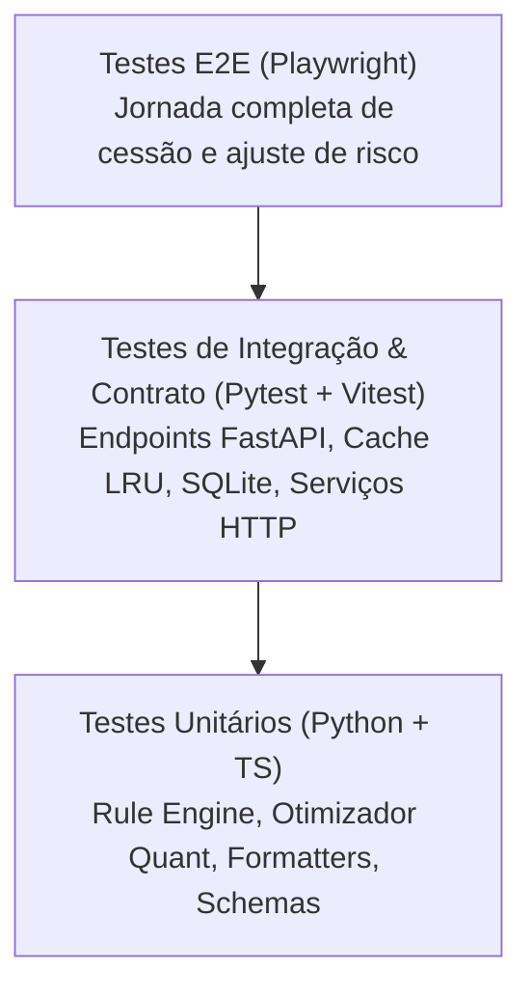

# RFC 0002: Estratégia, Especificação e Geração de Testes do ANTECIPE PRO
- **Status:** Proposto
- **Autor:** Antigravity (Pair Programming / QA & Arquitetura)
- **Data:** 24/10/2026
- **Contexto:** Hackathon ANTECIPE 2026 / FIDC Engine

---

## 1. Contexto e Motivação

O **ANTECIPE PRO** é um sistema crítico para operação financeira de FIDC (Fundo de Investimento em Direitos Creditórios), responsável por decidir a compra de recebíveis, calcular deságios e identificar riscos de fraude em frações de segundo.

Com a evolução rápida do projeto durante o hackathon e a resolução das incompatibilidades entre o frontend (React) e o backend (FastAPI), tornou-se indispensável formalizar uma **estratégia integrada de testes automatizados**.

### Riscos que os testes devem mitigar:
1. **Risco Financeiro:** Cálculo incorreto de deságio, prazos ou ultrapassagem de concentração de sacado/cedente em patrimônio líquido de R$ 53M.
2. **Risco de Fraude e Duplicidade:** Títulos cedidos em duplicidade no lote, no estoque do ANTECIPE ou em outros 17 fundos de mercado passando despercebidos.
3. **Risco de Contrato e Regressão:** Alterações em schemas do backend (Pydantic v2) que quebrem os componentes do frontend ou restaurem fallbacks indevidos para dados fictícios de demonstração.
4. **Risco de Segurança:** Endpoints de gestão de risco (`PUT /validators`) expostos sem autenticação ou vazamento de segredos em logs e respostas de erro.

---

## 2. Objetivos e Não-Objetivos

### Objetivos:
- Estabelecer a **Pirâmide de Testes** oficial do ANTECIPE PRO (Testes Unitários, Integração de Contrato, E2E e Carga).
- Garantir **100% de cobertura das 12 regras de negócio** e dos 3 níveis do Triplo Radar Anti-Fraude.
- Validar formalmente o **contrato REST unificado** (`/api/v1`) definido em `docs/CONTRATO_API.md`.
- Implementar testes automatizados para o **Frontend** (`Vitest` + `React Testing Library`), cobrindo serviços HTTP, gerenciamento de estado e interface.
- Implementar testes de **concorrência e persistência** no histórico SQLite e no cache LRU de idempotência.
- Assegurar tempo total de execução da suíte em CI/local em **menos de 30 segundos**.

### Não-Objetivos:
- Testes visuais por comparação de pixel/screenshot (foco em comportamento, dados e acessibilidade funcional).
- Mocks externos para serviços inexistentes no escopo atual (ex.: consulta real à RFB ao vivo; mock estático já atende).

---

## 3. Pirâmide de Testes e Arquitetura



| Nível | Escopo | Ferramentas | Localização | Meta de Cobertura |
|---|---|---|---|---|
| **Unitário (Back)** | Motor de regras, cálculo de deságio, parsers, otimizador | `pytest` | `backend/tests/test_*.py` | > 95% |
| **Unitário (Front)** | Formatadores, utilitários, parsing de CSV, simulações | `vitest` | `frontend/src/**/*.test.ts` | > 90% |
| **Integração (Back)** | Endpoints REST, Auth `X-API-Key`, SQLite, Idempotência | `pytest`, `TestClient`, `httpx` | `backend/tests/test_api.py` | 100% rotas |
| **Integração (Front)** | Camada de serviços HTTP, tratamento de erro, fallbacks | `vitest`, `msw` | `frontend/src/services/*.test.ts` | 100% serviços |
| **Componentes** | Drawer do gestor, formulários, badges de fraude, tabelas | `React Testing Library` | `frontend/src/components/**/*.test.tsx` | Fluxos críticos |
| **E2E / Carga** | Upload de 500 a 10.000 notas, concorrência | `pytest`, scripts python | `backend/tests/` & `scripts/` | Latência < 15ms |

---

## 4. Matriz de Casos de Teste Essenciais

### 4.1. Motor de Risco e Regras (`RuleEngine`)
- **T01 — Triplo Radar Anti-Fraude:**
  - *Cenário A:* Duplicidade dentro do mesmo lote (`DUPLICIDADE_LOTE`).
  - *Cenário B:* Duplicidade contra títulos do próprio ANTECIPE (`DUPLICIDADE_FUNDO`).
  - *Cenário C:* Título registrado em outro fundo do mercado (`FRAUDE_OUTRO_FUNDO`).
- **T02 — Concentração Stateful:**
  - *Cenário:* Soma de notas aprovadas consecutivas de uma mesma raiz de CNPJ que estoura o teto de 10% do PL durante o lote. As primeiras devem ser aprovadas e as excedentes recusadas por `CONCENTRACAO_MAXIMA_SACADO`.
- **T03 — Smart Batch Optimizer:**
  - *Cenário:* Lote onde a ordem original atinge o teto de concentração precocemente, descartando notas de alto valor. O otimizador guloso deve reordenar os títulos para maximizar o caixa líquido final, sem violar as regras de elegibilidade.
- **T04 — Zero-Deploy e Dynamic Config:**
  - *Cenário:* Desativar a regra `CNPJ_SACADO_VALIDO` via payload em memória; reavaliar o lote e confirmar que notas antes recusadas tornam-se aprovadas imediatamente.

### 4.2. Contrato da API REST e Segurança (`FastAPI`)
- **T05 — Autenticação de Gestor (`PUT /validators`):**
  - Sem header `X-API-Key` → `401 Unauthorized`.
  - Com header `X-API-Key` incorreto → `401 Unauthorized`.
  - Com `ADMIN_API_KEY` não configurada no backend → `403 Forbidden` (`PUT_DESABILITADO`).
  - Com chave válida → `200 OK` e persistência do arquivo JSON em disco.
- **T06 — Tratamento de Erros e Limites Operacionais (`POST /batches/validate`):**
  - Arquivo vazio (0 bytes) → `422 Unprocessable Entity` (`ARQUIVO_INVALIDO`).
  - CSV corrompido sem cabeçalhos obrigatórios → `422` com listagem das colunas faltantes.
  - Arquivo maior que 50 MB → `413 Payload Too Large` (`ARQUIVO_GRANDE_DEMAIS`).
  - Lote com mais de 10.000 linhas → `422` (`ARQUIVO_INVALIDO`).
- **T07 — Idempotência e Cache:**
  - Reenvio do mesmo arquivo CSV com mesmos parâmetros: tempo < 1 ms e cabeçalho `X-Idempotent-Replay: true`.
- **T08 — Persistência no Histórico SQLite:**
  - Cada lote validado deve gerar um registro na tabela `lotes_historico`, contendo hash, resumo financeiro e timestamp.

### 4.3. Frontend: Camada de Serviços e Interface
- **T09 — Serviço `salvarValidadores`:**
  - Deve injetar o header `X-API-Key`.
  - Se a API responder 401 ou 403, **não** deve acionar modo demo; deve disparar exceção para exibição do erro.
  - Se a API estiver offline (status 0), aciona fallback resiliente em memória.
- **T10 — Serviço `validarLote`:**
  - Se a API responder 413 ou 422, **não** deve substituir os dados por `mockLote.json`; deve propagar o erro para a tela.
  - Se o usuário não alterar a taxa mensal, o campo `taxa_mensal` **não** deve ser enviado no `FormData`.
- **T11 — Sincronização Dinâmica de Taxa:**
  - Inicialização do `App.tsx` consumindo `taxa_mensal_padrao` do endpoint `/health`.
- **T12 — Componente `GavetaGestor`:**
  - Renderização dinâmica dos parâmetros tipados (número, texto, lista).
  - Feedback visual de erro quando a API rejeita a gravação.

---

## 5. Implementação dos Testes e Comandos

### 5.1. Backend (`pytest`)
Estrutura de arquivos:
```
backend/tests/
├── test_analise_recusas.py      # Telemetria quant e distribuição Pareto
├── test_api.py                  # Endpoints REST, HTTP status, headers
├── test_carteira.py             # Validação de carteira de estoque
├── test_conformidade_gabarito.py# Comparação com o gabarito oficial de 100k
├── test_engine.py               # 12 regras individuais e triplo radar
├── test_historico.py            # SQLite e persistência de lotes
├── test_mock_receita.py         # Consulta de situação cadastral
├── test_regras_extras.py        # Limites combinados e corner cases
└── test_utils_estoque.py        # Carregador CSV e indexação em RAM
```

Comando de execução:
```bash
# Executa todos os testes do backend com relatório de tempo
cd backend
.\.venv\Scripts\pytest -v --durations=10
```

### 5.2. Frontend (`vitest` + `@testing-library/react`)
Instalação recomendada de dependências de desenvolvimento:
```bash
cd frontend
npm install --save-dev vitest @testing-library/react @testing-library/jest-dom jsdom msw
```

Configuração de execução no `package.json`:
```json
{
  "scripts": {
    "test": "vitest run",
    "test:watch": "vitest",
    "test:coverage": "vitest run --coverage"
  }
}
```

Exemplo de especificação de teste unitário do serviço frontend (`frontend/src/services/api.test.ts`):
```typescript
import { describe, it, expect, vi, beforeEach } from "vitest";
import { validarLote, salvarValidadores, ApiError } from "./api";

describe("Serviço de API - Contrato e Segurança", () => {
  beforeEach(() => {
    vi.restoreAllMocks();
  });

  it("salvarValidadores deve propagar erro 401 e não mascarar como sucesso", async () => {
    global.fetch = vi.fn().mockResolvedValue({
      ok: false,
      status: 401,
      json: async () => ({ error: { code: "NAO_AUTORIZADO", message: "API key inválida." } }),
    });

    await expect(salvarValidadores({ fundo: { nome: "X", cnpj: "" }, validadores: [] }))
      .rejects.toThrow("API key inválida.");
  });

  it("validarLote não deve acionar fallback de demo para erro 422 de CSV inválido", async () => {
    global.fetch = vi.fn().mockResolvedValue({
      ok: false,
      status: 422,
      json: async () => ({ error: { code: "ARQUIVO_INVALIDO", message: "Colunas obrigatórias faltantes." } }),
    });

    const file = new File(["invalido"], "teste.csv", { type: "text/csv" });
    await expect(validarLote(file)).rejects.toThrow("Colunas obrigatórias faltantes.");
  });
});
```

---

## 6. Pipeline de Validação Contínua (CI)

Proposta de GitHub Action (`.github/workflows/testes.yml`):
```yaml
name: Testes Automatizados - ANTECIPE PRO

on:
  push:
    branches: [ main, fix/** ]
  pull_request:
    branches: [ main ]

jobs:
  backend-tests:
    runs-on: ubuntu-latest
    steps:
      - uses: actions/checkout@v4
      - uses: actions/setup-python@v5
        with:
          python-version: '3.12'
      - name: Instalar dependências
        run: |
          python -m pip install --upgrade pip
          pip install -r backend/requirements.txt -r backend/requirements-dev.txt
      - name: Executar Pytest
        env:
          ADMIN_API_KEY: "chave-teste-ci"
        run: pytest backend/tests

  frontend-tests:
    runs-on: ubuntu-latest
    steps:
      - uses: actions/checkout@v4
      - uses: actions/setup-node@v4
        with:
          node-version: '20'
      - name: Typecheck
        run: |
          cd frontend
          npm ci
          npm run typecheck
      - name: Build de Produção
        run: |
          cd frontend
          npm run build
```

---

## 7. Critérios de Aceite e Próximos Passos

1. **Aprovação Formal:** Revisão deste RFC pela equipe do projeto.
2. **Setup do Vitest:** Adicionar scripts de teste automatizado no `frontend/package.json`.
3. **Execução Pré-Entrega:** Garantir que 100% dos 159 testes do backend e os testes do frontend executem com status verde antes do deploy final.
